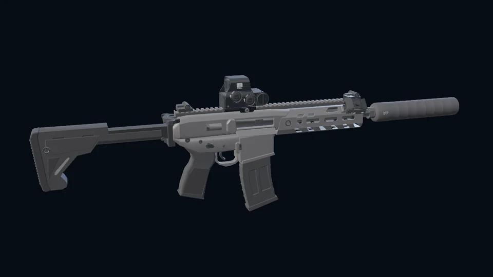

# Claude of Duty

**[Play Claude of Duty in your browser](https://edoardoluciani.github.io/Claude-of-Duty/)**

**The streets are quiet. They won't stay that way.**

Claude of Duty is a first-person survival shooter. Scout the market district before the first
wave, then hold out against increasingly tough squads. Spend the credits you earn between waves
on supplies, new weapons, and attachments. Or choose **Training Grounds** to try a build for free.


| The streets after dark                                                                                    | Build your loadout                                                                                              |
| --------------------------------------------------------------------------------------------------------- | --------------------------------------------------------------------------------------------------------------- |
|  |  |

## How to play

Use a desktop browser and device with **WebGPU** support. No installation is needed.
Choose **Survival** or **Training Grounds** from the Start menu. Once the level loads, click
**Start** to capture your mouse. If capture is denied, click **Retry Start**. The **Start** and
**Resume** buttons also request fullscreen with keyboard lock where supported; fullscreen is not
required to play.

In the Training briefing, choose **Day** or **Night** to preview the range before starting. The selected time stays fixed. At night the firing line and ladder have work lights; the distant targets are unlit.

At the Training Grounds firing line, press **T** to open the Supply Market at the
issue counter. Unlimited training credits buy builds, supplies and strike charges at normal market
prices; you can also clear all impact marks. The marked firing lanes run straight ahead from the
pavilion. In the yard on the left, vault the start hurdle to begin a parkour circuit; an on-screen
prompt shows each next move, and vaulting the hurdle again restarts it. The grenade bay is on the
right: hold and release the left button for a long throw or the right for a short one. With the
field radio equipped, press **Enter** to request the selected strike. Grenades and bombing runs can
wound or kill you here just as in Survival; after a lethal hit, choose **New Game** to return to the
firing line.

Use **Esc → Return to Start Menu** to choose another session without reloading. Look sensitivity,
field of view, invert Y, and firing shake carry over; range builds and charges never carry over to
Survival.

| Controls                  | Action                                  |
| ------------------------- | --------------------------------------- |
| WASD, mouse               | Move and look                           |
| Space, Shift, Ctrl or C   | Jump/vault, sprint, crouch/slide        |
| Z, Q / E                  | Go prone, lean                          |
| Left / right mouse button | Fire / hold to aim                      |
| R, 1 / 2                  | Reload, switch weapons                  |
| Hold T, hold H            | Collect ammo or intel, bandage          |
| G, X                      | Equip grenade, equip field radio        |
| F, L                      | Toggle flashlight, toggle mounted laser |
| Esc                       | Pause or close the market               |

Open **Esc → Controls** for the full reference. If you die, choose **New Game** to try again.

In the Supply Market, **Customize** the M4A1 to preview its bottom-rail **Hand stop**.
The draft shows less recoil and slightly slower aiming; applying it does not change ballistics.
It can stay on with the right-side laser. Select **None** under **Support** and apply to remove
it without a refund. Changing the draft alone never spends credits or changes the equipped gun.

## Run locally

Install the Bun version in [`package.json`](package.json), **Blender 5.3.0** and
[**gltfpack 1.3 with BasisU support**](build/README.md). The first build generates assets
and can take several minutes.

```sh
bun ci
bun run dev    # http://127.0.0.1:5173/
bun run verify # contributor checks; no Blender bake required
```

For a static build, run `bun run build` and serve `dist/` over HTTP locally or HTTPS online.
The **Build playable artifact** workflow can also build a downloadable copy without publishing.

[Contributor guide](AGENTS.md) · [Engine architecture](ARCHITECTURE.md) ·
[Asset and map editing](docs/assets.md)
