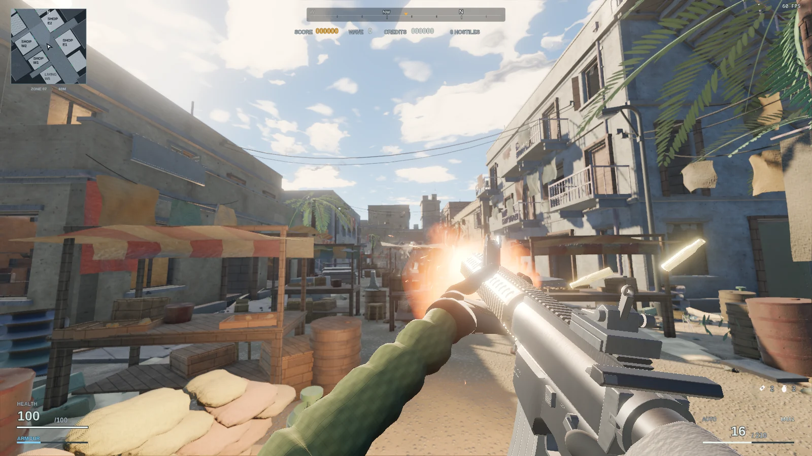
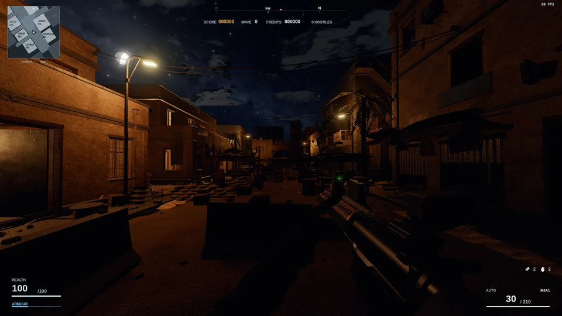

# Claude of Duty

**[Play Claude of Duty in your browser](https://edoardoluciani.github.io/Claude-of-Duty/)**

**The streets are quiet. They won't stay that way.**

Claude of Duty is a first-person survival shooter. Scout the market district before the first
wave, then hold out against increasingly tough squads. Spend the credits you earn between waves
on supplies, new weapons, and attachments. No download. Just open the game and hit **Start**.



| The streets after dark                                                                                    | Build your loadout                                                                                              |
| --------------------------------------------------------------------------------------------------------- | --------------------------------------------------------------------------------------------------------------- |
|  |  |

## How to play

Use a desktop browser and device with **WebGPU** support. No installation is needed.
Open the game, let it load, and click **Start** to capture your mouse. If capture is denied,
click **Retry Start**. The **Start** and **Resume** buttons also request fullscreen with keyboard
lock where supported; fullscreen is not required to play.

| Controls                  | Action                                  |
| ------------------------- | --------------------------------------- |
| WASD, mouse               | Move and look                           |
| Space, Shift, Ctrl or C   | Jump/vault, sprint, crouch/slide        |
| Z, Q / E                  | Go prone, lean                          |
| Left / right mouse button | Fire / hold to aim                      |
| R, 1 / 2                  | Reload, switch weapons                  |
| Hold T, hold H            | Collect ammo or intel, bandage          |
| G, X                      | Equip grenade, equip field radio        |
| F, L                      | Toggle flashlight, toggle mounted laser |
| Esc                       | Pause or close the market               |

Open **Esc → Controls** for the full reference. If you die, choose **New Game** to try again.

## Run locally

Install the Bun version in [`package.json`](package.json), **Blender 5.2.2** and
[**gltfpack 1.3 with BasisU support**](build/README.md). The first build generates assets
and can take several minutes.

```sh
bun ci
bun run dev    # http://127.0.0.1:5173/
bun run verify # contributor checks; no Blender bake required
```

For a static build, run `bun run build` and serve `dist/` over HTTP locally or HTTPS online.
The **Build playable artifact** workflow can also build a downloadable copy without publishing.

[Contributor guide](AGENTS.md) · [Engine architecture](ARCHITECTURE.md) ·
[Asset and map editing](docs/assets.md)
